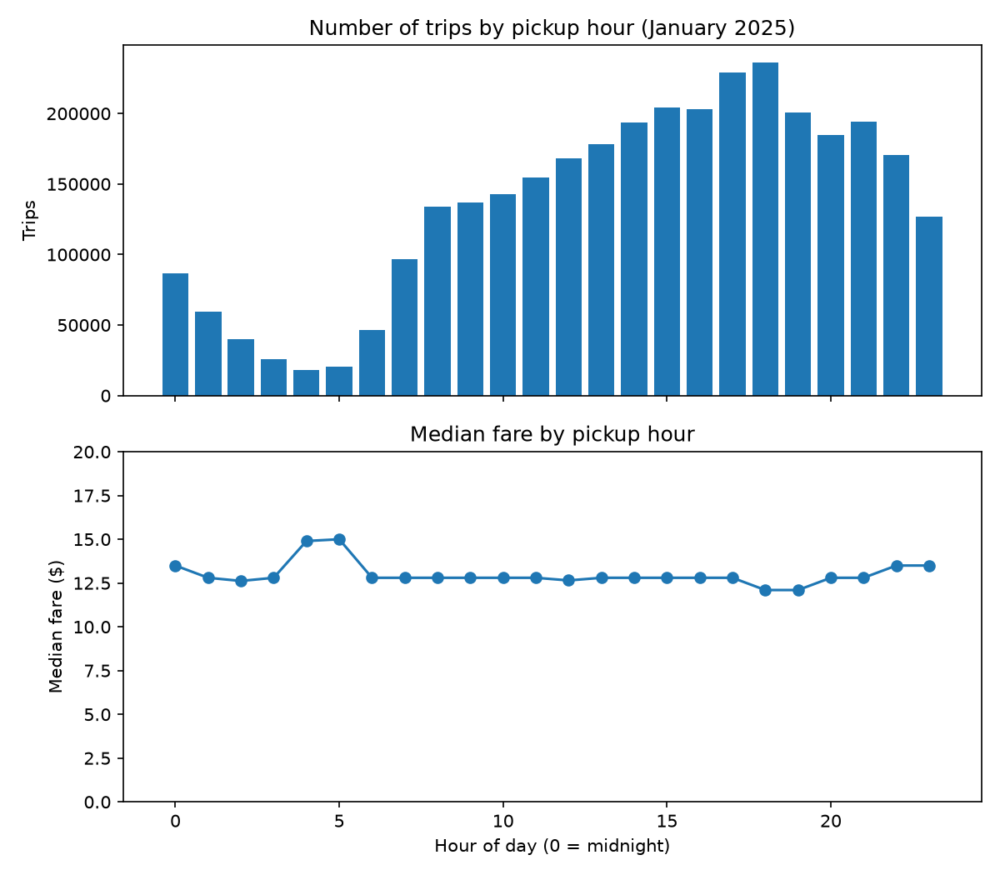

# NYC Taxi Trip Cleaning Pipeline

A small, tested Python pipeline that cleans one month of NYC yellow taxi trips (3.5 million rows) and records the reason for every trip it removes.

## Why I built this

Raw trip data has errors. In my first chart, a single trip with a fare of $863,372 for 1.6 miles pulled the average fare at noon up by about $5. Putting the cleaning rules in a script with tests, instead of a one-off notebook, means the same rules run the same way every time, and the work can be checked.

## What it does

- Reads one month of trips from a Parquet file.
- Applies the rules below and saves two files: `clean_<month>.parquet` and `rejected_<month>.parquet`.
- Rejected trips are never deleted silently. Each one is saved with the reason it was rejected.
- A trip that breaks several rules is counted once, under the first rule it breaks.
- The script stops with an error if kept + rejected does not equal the number of trips read.

## Results for January 2025

Trips in: 3,475,226. Kept: 3,252,281. Rejected: 222,945 (6.4%).

| Rejection reason | Trips |
|---|---|
| fare zero or negative | 130,434 |
| distance zero or negative | 90,196 |
| trip ends before or when it starts | 2,051 |
| distance over 100 miles | 161 |
| fare over $200 on a trip under 10 miles | 38 |
| total zero or negative | 23 |
| pickup outside the month | 22 |
| trip longer than 24 hours | 20 |

Kept but flagged, not removed:

- 413,153 trips with a missing passenger count. In the raw data, every missing passenger count was on a payment type 0 trip (listed as Flex Fare in the TLC data dictionary), so a missing count is not an error and removing these would have thrown away good trips.
- 23,631 trips with a passenger count of 0.
- 219 trips with a fare over $100 on a trip under 10 miles. These may be real (long waits, heavy traffic, tolls), so they are flagged for review instead of removed.

## Finding: the typical fare barely changes by hour

- The busiest hour is 6 pm (about 236,000 trips) and the quietest is 4 am (about 18,000 trips).
- The median fare is about $12 to $15 at every hour: lowest in the evening rush and highest at 4 to 5 am.
- Average fares looked very different, because a few extreme trips pull an average up. I used the median for that reason.
- This shows how fares differ by hour, not why. I did not test whether distance, traffic or airport trips explain the early-morning difference.

## How to run it

1. Download a month of yellow taxi trips (Parquet) from the NYC TLC Trip Record Data page and put the file in a folder named `data`. The data files are not included in this repository because of their size.
2. Install the libraries and run the pipeline:

        pip install -r requirements.txt
        python clean_data.py --input data/yellow_tripdata_2025-01.parquet --month 2025-01
        python -m pytest -v

## Tests

There are 15 tests in `test_clean_data.py`. Each uses a few made-up trips with a known right answer. They check that every rule rejects the right trips with the right reason, that missing and zero passenger counts are kept and flagged, that long trips with high fares are kept, and that the row counts always add up.

## Limitations

- Only one month (January 2025) was cleaned and analysed.
- The cutoffs ($200, $100 and 10 miles) were chosen by looking at this month's data. They have not been checked on other months.
- Zero and negative fares can be legitimate (disputes, refunds, no-charge trips). The pipeline rejects them because they cannot be used for a fare analysis, not because they are always errors.
- Fares exclude tips and extras.
- The hourly analysis does not separate weekdays from weekends.

## Files

- `clean_data.py`: the pipeline.
- `test_clean_data.py`: the tests.
- `01_explore.ipynb`: the exploration that led to the rules.
- `fares_by_hour.png`: the chart above.

Data: NYC Taxi and Limousine Commission (TLC) Trip Record Data.
